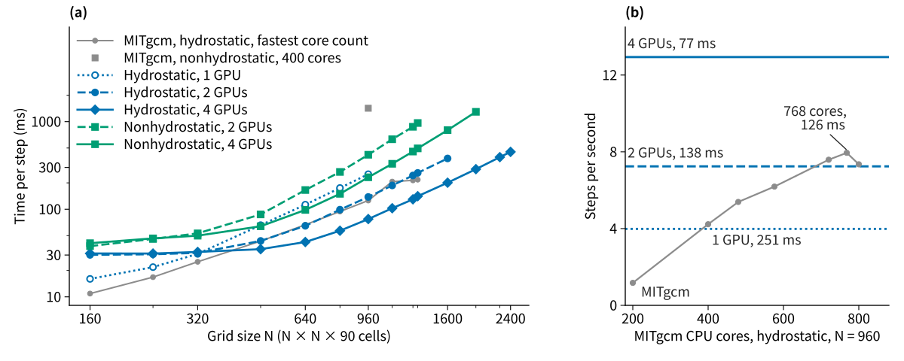

# LOCOMgcm

LOCOMgcm is a differentiable ocean general circulation model developed by
the Laboratory of Ocean Circulation Observing and Modeling (LOCOM) at the
Institute of Deep-sea Science and Engineering, Chinese Academy of Sciences.
It is
differentiable, numerically equivalent to MITgcm and its adjoint, and fast.
LOCOMgcm implements the MITgcm ocean discretizations in PyTorch, supports
regional and global grids, and runs on NVIDIA GPUs.

**LOCOMgcm: A Differentiable, Fast Ocean General Circulation Model in PyTorch**

Haoyang Tang<sup>1,2</sup>, Hongzhou Xu<sup>1,\*</sup>, Bo Hong<sup>3</sup>, Wei Zhou<sup>4,5</sup>

<details>
<summary>Affiliations</summary>

<sup>1</sup> Institute of Deep-sea Science and Engineering, Chinese Academy of Sciences, Sanya, China<br>
<sup>2</sup> University of Chinese Academy of Sciences, Beijing, China<br>
<sup>3</sup> School of Civil and Transportation Engineering, South China University of Technology, Guangzhou, China<br>
<sup>4</sup> China-Sri Lanka Belt and Road Joint Laboratory on Tropical Oceanography, Guangzhou, China<br>
<sup>5</sup> Public Instrument and Equipment Service Center, South China Sea Institute of Oceanology, Chinese Academy of Sciences, Guangzhou, China<br>
<sup>\*</sup> Corresponding author: Hongzhou Xu (hzxu@idsse.ac.cn)

</details>


Surface currents over 29 days in the South China Sea and western Pacific at
1/32° resolution (960 × 912 × 90 cells). MITgcm is on the left and LOCOMgcm on
the right.

## Numerical comparison


RMS temperature differences over all wet cells, sampled every six hours.
Blue compares LOCOMgcm with MITgcm; orange compares two MITgcm runs with
different process layouts, which change the order of their global sums.

## Performance



Time per step in double precision. Left: N × N × 90 grids with LOCOMgcm on
one, two and four A800 GPUs and MITgcm on CPUs. Right: the MITgcm CPU core
count comparison at N = 960 against LOCOMgcm on one, two and four GPUs.

## Installation

Use Python 3.11 or later. The tested dependency versions are listed in
[`requirements-runtime.txt`](requirements-runtime.txt). Install a PyTorch
build compatible with your CUDA environment, then install LOCOMgcm. The
Python package is named `defgcm`:

```sh
python -m pip install torch==2.9.0          # or the CUDA build for your machine
python -m pip install -r requirements-runtime.txt
python -m pip install --no-deps -e .
python -c 'import defgcm; print(defgcm.__file__)'
```

The optional native CUDA operators compile on first use and require a
compatible CUDA toolkit and C++ compiler. Python reference operators are
included. Every process that imports `defgcm` prints an accelerator
report to stderr at exit; `DEFGCM_ACCEL_REPORT=0` turns it off.

## Running a case

The built-in `pureocean` case (36 x 36 x 10 cells) runs on a CPU in about
15 s once its synthetic inputs exist:

```sh
python examples/make_synthetic_inputs.py
python -m experiments.pipeline_v2.run_pipeline \
  --config experiments/configs/cases/pureocean.yaml \
  --overlay examples/pureocean_cpu.yaml \
  --run-id pureocean_cpu
```

pureocean sets `mit_comparison.enabled: false`, so this prepares the inputs
(stage 1a), writes the LOCOMgcm inputs (1b), runs the model (2) and
postprocesses (4) into `outputs/data/pureocean_cpu/preprocessed.zarr`. MITgcm
is optional: `mit_comparison.enabled: true` adds the MITgcm export (1c), the
MITgcm run (3) and the comparison (5), which need a configured MITgcm tree.

[`docs/USAGE.md`](docs/USAGE.md) explains this run, the output layout,
driving the model and its gradient from Python with the scripts in
`examples/`, writing your own case file, GPU kernels and troubleshooting.

Case configurations are in `experiments/configs/cases/`. Each configuration
specifies the grid, physics, initial state, forcing, boundary conditions and
output settings. Set its input paths before running the pipeline. Prepared
inputs and data sources are described in [`docs/INPUTS.md`](docs/INPUTS.md).

From the repository root, inspect the Python driver options:

```sh
python -m experiments.pipeline_v2.run_pipeline --help
```

The published regional cases need the real inputs described in
`docs/INPUTS.md`. For example, within a suitable compute allocation:

```sh
python -m experiments.pipeline_v2.run_pipeline \
  --config experiments/configs/cases/scs_paper_h160.yaml \
  --run-id regional_h160
```

Without `--stages`, a case with `mit_comparison.enabled: true`, such as
`scs_paper_h160`, runs every stage: input preparation, LOCOMgcm and MITgcm
execution, postprocessing and comparison. `--stages` selects individual
stages, and `--stages all` names every stage; with the switch off, a list that
includes the MITgcm stages is refused before anything runs.

On SLURM clusters, `experiments/pipeline_v2/run_case.sh` submits the stages.
Set `DEFGCM_PYTHON`, `DEFGCM_ENV_SETUP`, `CPU_PARTITION`, `CPU_NODELIST`,
`DEFGCM_PARTITION` and `DEFGCM_NODELIST` for the destination cluster. Empty
placement settings use the SLURM defaults. `STAGES`,
`STEPS`, `DEFGCM_NPROC`, `MITGCM_ROOT`, `MITGCM_OPTFILE` and
`MITGCM_MPI_LAUNCHER` select stages, run length, device count and native build
settings. The shell driver's header documents these options.

## Twin experiment and adjoint builds

`experiments/da_twin/` contains the South China Sea twin experiment: 4D-Var,
the analysis network trained online, the gradient check of a network inside
the time steps, and the evaluation. Its README lists the inputs
and the commands.

`verification/adjoint/` contains the MITgcm adjoint builds used for the
gradient comparisons: the modified MITgcm code directories, build options and
runtime namelists for the regional South China Sea configuration (`scs_h`), the
cubed-sphere configuration (`cs32`) and the global configuration with
atmospheric forcing (`global_with_exf`). Building them requires MITgcm, a
Fortran compiler, NetCDF, Java and Tapenade.

## License and citation

Copyright (C) 2026 Laboratory of Ocean Circulation Observing and Modeling
(LOCOM). LOCOMgcm is free software distributed
under the [GNU General Public License, version 3](LICENSE) (GPL-3.0-only).
MITgcm-derived files retain the notices in [THIRD_PARTY_NOTICES.md](THIRD_PARTY_NOTICES.md).
See [CITATION.md](CITATION.md) for citation guidance.
