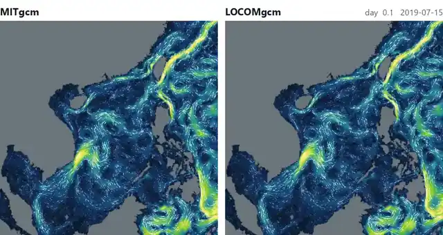
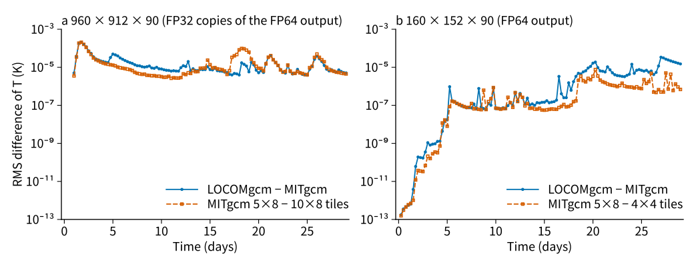
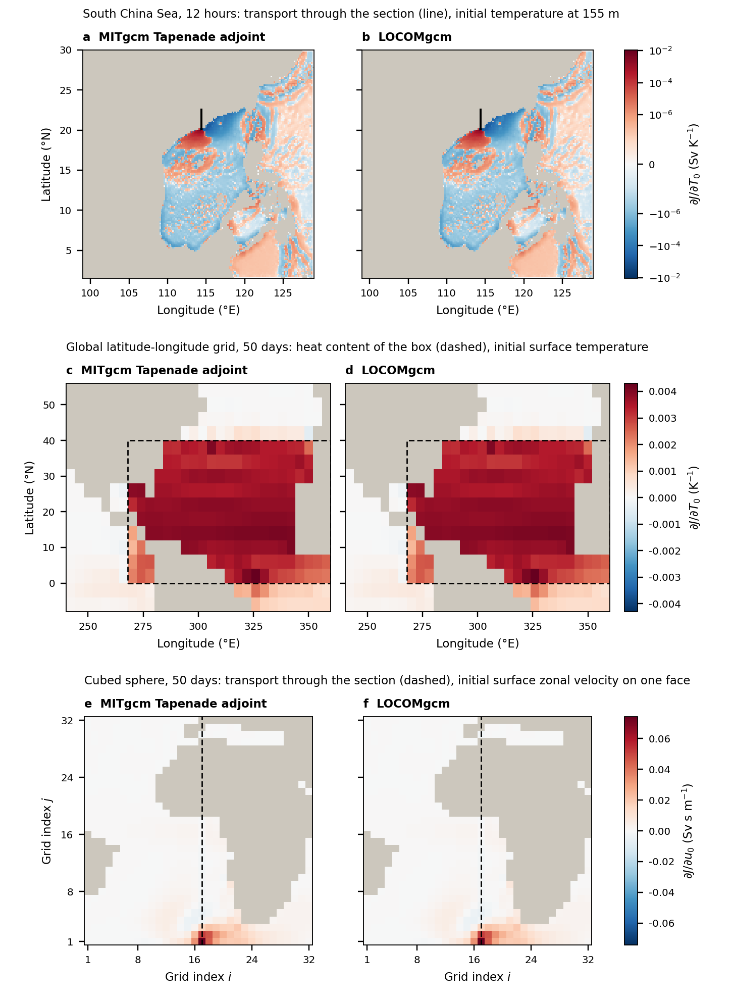

# LOCOMgcm

LOCOMgcm is a differentiable ocean general circulation model developed by
the Laboratory of Ocean Circulation Observing and Modeling (LOCOM) at the
Institute of Deep-sea Science and Engineering, Chinese Academy of Sciences.
It is differentiable and fast, and over the South China Sea its integrations
and gradients match those of MITgcm and its Tapenade adjoint, with differences
comparable to those between two MITgcm runs differing only in summation order.
LOCOMgcm implements the MITgcm ocean discretizations in PyTorch, supports
regional and global grids, and runs on NVIDIA GPUs.

**LOCOMgcm: A Differentiable, Fast Ocean General Circulation Model in PyTorch**

Haoyang Tang<sup>1,2</sup>, Hongzhou Xu<sup>1,\*</sup>, Bo Hong<sup>3</sup>, Wei Zhou<sup>4,5</sup>

<details>
<summary>Affiliations</summary>

<sup>1</sup> Institute of Deep-sea Science and Engineering, Chinese Academy of Sciences, Sanya, China<br>
<sup>2</sup> University of Chinese Academy of Sciences, Beijing, China<br>
<sup>3</sup> School of Civil and Transportation Engineering, South China University of Technology, Guangzhou, China<br>
<sup>4</sup> China-Sri Lanka Belt and Road Joint Laboratory on Tropical Oceanography, Guangzhou, China<br>
<sup>5</sup> Public Instrument and Equipment Service Center, South China Sea Institute of Oceanology, Chinese Academy of Sciences, Guangzhou, China<br>
<sup>\*</sup> Corresponding author: Hongzhou Xu (hzxu@idsse.ac.cn)

</details>



Surface currents over 29 days in the South China Sea and western Pacific at
1/32° resolution (960 × 912 × 90 cells). MITgcm is on the left and LOCOMgcm on
the right.

## Comparison with MITgcm

LOCOMgcm cannot reproduce MITgcm bit for bit, because the order of
floating-point operations differs between the two codes, between compilers,
and between CPUs and GPUs. The size of a rounding difference of MITgcm is
therefore measured with a reference pair: two MITgcm runs with different
process decompositions. In the forward integration, the two decompositions
change only the order of the global sums.

### Forward integration



RMS temperature differences over all ocean points, sampled every six hours, on
(a) the 960 × 912 × 90 grid and (b) the 160 × 152 × 90 grid. Blue compares
LOCOMgcm with MITgcm; orange compares the two MITgcm runs of the reference
pair. All runs use double precision (FP64). In (a) the differences are
computed from single-precision (FP32) copies of the output, and the times
before day 1, whose differences FP32 cannot resolve, are left out. In (b)
they are computed from the FP64 output.

RMS differences of the 29-day South China Sea integrations over all ocean
points and output times (every six hours):

| Field | 960 × 912 × 90: LOCOMgcm − MITgcm | 960 × 912 × 90: reference pair | 160 × 152 × 90: LOCOMgcm − MITgcm | 160 × 152 × 90: reference pair |
|---|---|---|---|---|
| Temperature (K) | 3.6 × 10⁻⁵ | 4.0 × 10⁻⁵ | 7.9 × 10⁻⁶ | 1.4 × 10⁻⁶ |
| Salinity | 9.8 × 10⁻⁶ | 1.0 × 10⁻⁵ | 7.5 × 10⁻⁶ | 3.4 × 10⁻⁶ |
| Zonal velocity (m s⁻¹) | 1.2 × 10⁻⁵ | 1.2 × 10⁻⁵ | 2.3 × 10⁻⁶ | 4.2 × 10⁻⁷ |
| Meridional velocity (m s⁻¹) | 1.1 × 10⁻⁵ | 1.0 × 10⁻⁵ | 1.1 × 10⁻⁶ | 1.7 × 10⁻⁷ |
| Sea surface height (m) | 9.3 × 10⁻⁷ | 9.5 × 10⁻⁷ | 2.4 × 10⁻⁷ | 8.1 × 10⁻⁸ |

The reference pair uses 5 × 8 and 10 × 8 process tiles on the
960 × 912 × 90 grid and 5 × 8 and 4 × 4 on the 160 × 152 × 90 grid. On the
960 × 912 × 90 grid the differences are computed from single-precision
copies of the double-precision output.

### Gradient

The gradient of LOCOMgcm is compared with the adjoint of MITgcm generated by
Tapenade.



Sensitivities from the Tapenade adjoint of MITgcm (left) and from LOCOMgcm
(right). (a, b) South China Sea, 160 × 152 × 90 cells: sensitivity of the
12-hour mean volume transport through a section (black line) to the initial
temperature at 155 m, the depth of the largest sensitivity; the color scale
is logarithmic in magnitude above 10⁻⁶ of the largest value. (c, d) Global
latitude-longitude grid with atmospheric forcing, 90 × 40 × 15 cells:
sensitivity of the heat content of a box (dashed) after 50 days to the
initial surface temperature. (e, f) Cubed sphere with 32 × 32 columns per
face and 15 levels: sensitivity of the 50-day mean volume transport through
a section (dashed) to the initial surface zonal velocity on the face of the
section.

| Configuration | Window | Controls | Cost functions | Gradients |
|---|---|---|---|---|
| South China Sea, 160 × 152 × 90 | 12 hours, 360 steps | Initial temperature and salinity, 731,898 ocean points each | 2.9 × 10⁻¹⁴ | 7.1 × 10⁻¹¹ |
| Global latitude-longitude, 90 × 40 × 15 | 50 days, 3600 steps | Initial temperature and salinity, wind stress and heat flux, 237,600 values | 1.9 × 10⁻¹³ | 5.5 × 10⁻¹¹ |
| Cubed sphere, 32 × 32 columns per face, 15 levels | 50 days, 3600 steps | Initial temperature, salinity and horizontal velocity, 215,520 values | 4.3 × 10⁻¹¹ | 3.4 × 10⁻⁹ |

The cost-function column gives the relative difference between the two
models. The gradient column gives the largest absolute difference of a
control variable divided by the largest adjoint gradient of that variable,
and of these the largest over the control variables. The South China Sea
window uses `experiments/configs/cases/scs_paper_h160_expl12h.yaml`.

In a three-day window of the twin experiment (160 × 152 × 41 cells with KPP
and open boundaries), the cost function is the volume-mean temperature of a
box at the end of the window, and the controls are the initial temperature
and salinity. The relative differences below divide the largest and the RMS
difference over the 372,522 ocean points of each control by the largest and the
RMS gradient of the MITgcm adjoint with the 5 × 8 decomposition. The
reference pair consists of the MITgcm adjoint runs with the 4 × 4 and 5 × 8
decompositions.

| Control | LOCOMgcm − MITgcm adjoint: largest | LOCOMgcm − MITgcm adjoint: RMS | Reference pair: largest | Reference pair: RMS |
|---|---|---|---|---|
| Temperature | 4.3 × 10⁻⁹ | 9.5 × 10⁻¹⁰ | 1.1 × 10⁻⁸ | 1.2 × 10⁻⁹ |
| Salinity | 8.8 × 10⁻⁴ | 6.6 × 10⁻⁵ | 1.2 × 10⁻³ | 7.9 × 10⁻⁵ |

## Performance


Time per step of the forward integration in double precision. Left: LOCOMgcm
on one, two and four A800 GPUs in the hydrostatic configuration and on two and
four GPUs in the nonhydrostatic configuration, against the grid size N of the
N × N × 90 grids. Gray marks MITgcm: the fastest hydrostatic time of each grid
over the tested core counts (640 to 896 cores), and the nonhydrostatic time at
N = 960 on 640 cores, its fastest tested core count. Right: hydrostatic steps
per second on the 960 × 960 × 90 grid, MITgcm against its number of CPU cores
and LOCOMgcm on one, two and four GPUs (horizontal lines).

Time per step of the hydrostatic forward integration on N × N × 90 grids, in
ms. The MITgcm column gives the fastest run of each grid over the tested
core counts, with that core count in parentheses.

| N | 1 GPU | 2 GPUs | 4 GPUs | MITgcm (cores) | MITgcm / 4 GPUs |
|---|---|---|---|---|---|
| 160 | 16.0 | 30.2 | 31.3 | 10.9 (640) | 0.35 |
| 480 | 65.8 | 43.5 | 35.0 | 43.3 (768) | 1.24 |
| 640 | 112.8 | 64.7 | 42.3 | 66.5 (640) | 1.57 |
| 800 | 174.8 | 98.9 | 56.9 | 94.2 (640) | 1.66 |
| 960 | 251.1 | 138.1 | 77.3 | 125.8 (768) | 1.63 |
| 1120 | | 186.9 | 102.7 | 206.6 (896) | 2.01 |
| 1280 | | 242.9 | 129.8 | 213.7 (640) | 1.65 |
| 1320 | | 259.9 | 140.9 | 217.7 (792) | 1.54 |
| 1920 | | | 286.8 | | |
| 2400 | | | 451.7 | | |

LOCOMgcm ran on a node with four NVIDIA A800 GPUs (80 GiB each, connected by
NVLink); each value is the median of 80 steps after 20 discarded steps.
MITgcm ran on nodes with two 14-core Intel Xeon Gold 6132 processors, one
process per core; each value is the mean over 100 steps. Input and output
are excluded. Empty cells were not run or exceed the memory of the GPUs.

On the grids from N = 480 to N = 1320, four GPUs run the hydrostatic step 1.2
to 2.0 times as fast as the fastest MITgcm run of each grid (last column). On the 960 × 960 × 90 grid, where
MITgcm is fastest on 768 cores, four GPUs run the step 1.6 times as fast. In
the nonhydrostatic configuration on the same grid, four GPUs take 231.6 ms
per step and MITgcm 821.8 ms on 640 cores, its fastest tested core count, so
the step is 3.5 times as fast. From N = 960 on, each doubling of the number
of GPUs shortens the hydrostatic step by a factor of 1.8 to 1.9.

One gradient evaluation over a window of 100 steps (50 steps on four GPUs
from N = 1120 on), with a state stored at every step, costs 2.9 to 5.3 times
the forward integration of the same window on the grids from N = 160 to
N = 1320 on one, two and four GPUs. The
exception is one GPU at N = 800, where the intermediate quantities of a step
nearly fill the memory of the GPU and the gradient costs 14.0 times the
forward integration.

## Installation

Use Python 3.11 or later. The tested dependency versions are listed in
[`requirements-runtime.txt`](requirements-runtime.txt). Install a PyTorch
build compatible with your CUDA environment, then install LOCOMgcm. The
Python package is named `locomgcm`:

```sh
python -m pip install torch==2.9.0          # or the CUDA build for your machine
python -m pip install -r requirements-runtime.txt
python -m pip install --no-deps -e .
python -c 'import locomgcm; print(locomgcm.__file__)'
```

The optional native CUDA operators compile on first use and require a
compatible CUDA toolkit and C++ compiler. Python reference operators are
included. Every process that imports `locomgcm` prints an accelerator
report to stderr at exit; `LOCOMGCM_ACCEL_REPORT=0` turns it off.

## Running a case

The built-in `pureocean` case (36 x 36 x 10 cells) runs on a CPU in about
15 s once its synthetic inputs exist:

```sh
export LOCOMGCM_SYNTHETIC_PUREOCEAN_DIR="$PWD/data/synthetic_pureocean"
python examples/make_synthetic_inputs.py --out "$LOCOMGCM_SYNTHETIC_PUREOCEAN_DIR"
python -m experiments.pipeline_v2.run_pipeline \
  --config experiments/configs/cases/pureocean.yaml \
  --overlay examples/pureocean_cpu.yaml \
  --run-id pureocean_cpu
```

pureocean sets `mit_comparison.enabled: false`, so this prepares the inputs
(stage 1a), writes the LOCOMgcm inputs (1b), runs the model (2) and
postprocesses (4) into `outputs/data/pureocean_cpu/preprocessed.zarr`. MITgcm
is optional: `mit_comparison.enabled: true` adds the MITgcm export (1c), the
MITgcm run (3) and the comparison (5), which need a configured MITgcm tree.

[`docs/USAGE.md`](docs/USAGE.md) explains this run, the output layout,
driving the model and its gradient from Python with the scripts in
`examples/`, writing your own case file, GPU kernels and troubleshooting.

Case configurations are in `experiments/configs/cases/`. Each configuration
specifies the grid, physics, initial state, forcing, boundary conditions and
output settings. Set its input paths before running the pipeline. Prepared
inputs and data sources are described in [`docs/INPUTS.md`](docs/INPUTS.md).

From the repository root, inspect the Python driver options:

```sh
python -m experiments.pipeline_v2.run_pipeline --help
```

The published regional cases need the real inputs described in
`docs/INPUTS.md`. For example, within a suitable compute allocation:

```sh
python -m experiments.pipeline_v2.run_pipeline \
  --config experiments/configs/cases/scs_paper_h160.yaml \
  --run-id regional_h160
```

Without `--stages`, a case with `mit_comparison.enabled: true`, such as
`scs_paper_h160`, runs every stage: input preparation, LOCOMgcm and MITgcm
execution, postprocessing and comparison. `--stages` selects individual
stages, and `--stages all` names every stage; with the switch off, a list that
includes the MITgcm stages is refused before anything runs.

On SLURM clusters, `experiments/pipeline_v2/run_case.sh` submits the stages.
Set `LOCOMGCM_PYTHON`, `LOCOMGCM_ENV_SETUP`, `CPU_PARTITION`, `CPU_NODELIST`,
`LOCOMGCM_PARTITION` and `LOCOMGCM_NODELIST` for the destination cluster. Empty
placement settings use the SLURM defaults. `STAGES`,
`STEPS`, `LOCOMGCM_NPROC`, `MITGCM_ROOT`, `MITGCM_OPTFILE` and
`MITGCM_MPI_LAUNCHER` select stages, run length, device count and native build
settings. The shell driver's header documents these options.

## Twin experiment and adjoint builds

`experiments/da_twin/` contains the South China Sea twin experiment: 4D-Var,
the analysis network trained online, the gradient check of a network
evaluated at every time step, and the evaluation. Its README lists the inputs
and the commands.

`verification/adjoint/` contains the MITgcm adjoint builds used for the
gradient comparisons: the modified MITgcm code directories, build options and
runtime namelists for the regional South China Sea configuration (`scs_h`), the
cubed-sphere configuration (`cs32`) and the global configuration with
atmospheric forcing (`global_with_exf`). Building them requires MITgcm, a
Fortran compiler, NetCDF, Java and Tapenade.

## Documentation

| Document | Contents |
|---|---|
| [`docs/USAGE.md`](docs/USAGE.md) | Running cases, the output layout, driving the model and its gradient from Python, case files, GPU kernels and troubleshooting |
| [`docs/INPUTS.md`](docs/INPUTS.md) | External paths, prepared input archives and data sources |
| [`docs/SUPPORT.md`](docs/SUPPORT.md) | The cases compared with MITgcm and the MITgcm options that LOCOMgcm has and lacks |
| [`docs/NUMERICS.md`](docs/NUMERICS.md) | Index, sign and mask conventions and their relation to MITgcm |
| [`docs/VALIDATION.md`](docs/VALIDATION.md) | How to compare LOCOMgcm with MITgcm and how to judge a difference |
| [`docs/COMPILE_COMPAT.md`](docs/COMPILE_COMPAT.md) | The fixes installed for `torch.compile` with PyTorch 2.9 and Triton 3.5 |

## License and citation

Copyright (C) 2026 Laboratory of Ocean Circulation Observing and Modeling
(LOCOM). LOCOMgcm is free software distributed
under the [GNU General Public License, version 3](LICENSE) (GPL-3.0-only).
MITgcm-derived files retain the notices in [THIRD_PARTY_NOTICES.md](THIRD_PARTY_NOTICES.md).
See [CITATION.md](CITATION.md) for citation guidance.
